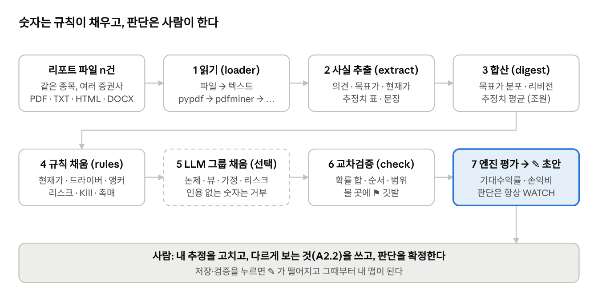
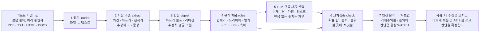

# 리포트에서 마인드맵까지

작성 2026-10-20 · hsc65 · 원본(편집·댓글): https://claude.ai/code/artifact/1d02f708-6186-4b84-aa2a-9df064292042

증권사 리포트 여러 건을 주면 kstock-mindmap 이 A 맵(신규 투자 맵) 초안을 만드는 과정을, 삼성전자 예제로 단계마다 따라간다.

> **2026-10-21 갱신 — 설계 v3 적용.** 이 문서는 M0(v1) 경로의 설명이라 4단계의 "앵커·확률·Kill 자동 채움" 과 "내 추정 = 컨센서스" 는
> **이제 하지 않는다.** v3 (`report-draft-design-v3.md`) 에서는 ① 정성 노드가 전부 Claim(리포트 인용 span) 에서 나오고
> (`reports/claims.py` → `validate_claims.py` → `generate/issues.py` → `generate/mapping.py`), ② 시나리오는 리포트가 명시한 케이스만
> 쓰며 (`generate/scenarios.py`), ③ 내 추정·확률·Kill·내재 가정은 비워 `pending` 태그로 남기고 (빈 칸은 미확정, 오류 아님), ④ 집계는
> 증권사별 최신 1건 · 45일 · 실적 전 표시 · 중앙값+범위, ⑤ 새 리포트는 변경안(`generate/changes.py`) 으로 제안되어 사람이 승인한다.
> 1~3단계(읽기·추출·합산)와 6~7단계(교차검증·엔진) 의 설명은 그대로 유효하다. 명령은 README 의 "설계 v3" 절을 본다.

## 한눈에 보는 흐름

리포트 n건은 7단계를 거쳐 A 맵 초안이 된다. 숫자(현재가·컨센서스·추정치)는 규칙이 채우고, 논제와 판단은 사람이 쓴다.





1~4단계는 `src/kstock/reports/`(loader · extract · digest), 5~7단계는 `src/kstock/generate/`(rules · llm_fill · check · draft)가 맡는다. 5단계는 `.env`에 `ANTHROPIC_API_KEY`가 있을 때만 돌고, 없으면 4단계 결과로 바로 6단계로 간다. 초안의 모든 값에는 `draft` 태그(마인드맵의 ✎)가 붙고 판단(A6.5)은 항상 WATCH다.

## 입력 — 같은 종목의 리포트를 여러 건

한 종목의 증권사 리포트를 2~5건 모아 주면 가장 좋다. 1건이면 컨센서스가 아니라 한 증권사의 뷰가 되고, 섹터·시황 리포트는 목표주가가 없어 쓸모가 적다.

| 받는 것 | 조건 | 안 되는 것 |
|---|---|---|
| PDF (증권사 원문) | 글자가 들어 있는 PDF. `pypdf`·`pdfminer.six`·`pdfplumber`·`pdftotext` 중 설치된 것으로 읽는다 | 스캔 이미지 PDF — 글자가 없어 건너뛰고 경고한다 |
| TXT · MD | 리포트 본문을 붙여 넣은 텍스트 | — |
| HTML · DOCX | 태그를 벗겨 본문만 쓴다 | — |

이 문서의 예제는 `examples/reports_draft/`의 **가상 삼성전자 리포트 3건**이다. 실제 증권사 표지 양식(하나·KB·키움 스타일)을 흉내 냈고 숫자는 지어낸 것이다.

| 파일 | 증권사 스타일 | 날짜 | 투자의견 | 목표주가 | 현재주가 |
|---|---|---|---|---|---|
| `hana_005930_20261012.pdf` | 하나증권 | 2026-10-12 | BUY (Maintain) | 480,000원 (상향, 직전 380,000) | 258,000원 (10/10) |
| `kb_005930_20261012.pdf` | KB증권 | 2026-10-12 | Buy (유지) | 600,000원 (상향) | 258,000원 (26.10.10) |
| `kiwoom_005930_20261007.pdf` | 키움증권 | 2026-10-07 | Outperform (유지) | 350,000원 (유지) | 262,000원 (10/6) |

세 리포트 모두 본문에 `삼성전자 (005930)`이 있어 종목은 자동으로 잡힌다. 코드가 없는 리포트는 대화상자나 `--ticker`로 알려 준다.

## 1·2단계 — 읽고, 표지에서 사실을 뽑는다

리포트 한 건은 `ReportFacts` 하나가 된다. 전부 규칙(정규식·표 파서)으로 뽑고, 못 찾은 값은 None으로 두지 지어내지 않는다. PDF 텍스트는 2단 조판이 섞여 지저분하므로, 후보를 모아 **표지(앞 4,000자) 안에서 가장 자주 나온 값**을 고른다.

하나증권 스타일 리포트에서 실제로 뽑힌 값:

| 항목 | 표지의 글 | 뽑힌 값 | 어떻게 |
|---|---|---|---|
| 종목 | `삼성전자 (005930)` | 005930 · 삼성전자 | 괄호 안 6자리 코드, 본문 앞부분에서 최다 빈도 |
| 날짜 | `Company Report 2026.10.12` | 2026-10-12 | `2026.10.12` `2026-10-12` `2026년 10월 12일` `26.4.15` 전부 읽음 |
| 증권사 | `하나증권 리서치센터`, `@hanafn.com` | 하나증권 | 증권사 이름 목록 + 이메일 도메인 |
| 투자의견 | `BUY (Maintain)` | BUY · 유지 | 매수/Buy/Outperform → BUY, 중립/Hold/Trading Buy → HOLD, 매도 → SELL, Not Rated → NR |
| 목표주가 | `목표주가(12M) 480,000원 (상향)` | 480,000 · 상향 | `18만원`도 읽음. 직전값 380,000은 표지 끝의 「투자의견 변동 내역」 표에서 |
| 현재주가 | `현재주가 (10/10) 258,000원` | 258,000 (2026-10-10) | 괄호의 날짜는 리포트 연도로 보완 |
| 52주 고·저 | `52주 최고/최저 374,500 / 189,200` | 374,500 / 189,200 | Bear 앵커에 쓴다 |
| 추정치 표 | `(십억원, IFRS 연결) 2024A 2025A 2026E 2027E 2028E` 아래 행들 | 영업이익 2027E 420,000 십억원, EPS 50,500원, PER 5.1배 … | 연도가 3개 이상 나란한 줄이 표 머리. 단위는 그 줄이나 위 3줄에서 |
| 분기 표 | `1Q26 2Q26 3Q26P 4Q26E …` | 3Q26 실적 107,400, 4Q26E 64,000 | P(잠정)는 실적으로, 분기 말이 기준일 전이면 실적 |

표를 읽을 때 조심하는 것: `매출액 증가율` 처럼 증가율·YoY 행은 제외하고, `(5)`는 음수, `적전`은 빈 칸, 두 표가 나란히 붙어 있으면 앞 표만 읽는다. 한 리포트에 연도 머리를 단 표가 여럿이면(요약 표·사업부 전망·중장기 목표·밸류 표) 가장 믿음직한 표(매출액이 금액답고, 지표가 많고, 실적 열이 있는 표)를 기준으로 삼고, 다른 표의 값은 기준 표에 있는 연도이고 크기가 맞을 때만(같은 지표 중앙값의 1/5~5배) 빈 칸에 보탠다 — 2030E·2035E 같은 장기 목표가 열을 늘리거나 사업부 숫자가 전사 숫자를 덮는 것을 막는다. PDF 가 `287 ,000`·`19 .5` 처럼 숫자를 벌려 놓은 것은 읽기 전에 다시 붙인다.

리포트 제목은 표지에서 날짜·증권사·종목코드·섹터 라벨(`인터넷/게임`)·의견 줄(`매수 (유지)`)·데이터 박스(액면가·자본금)·리포트 종류(`Company Brief`)를 뺀 첫 제목다운 줄을 고른다. 본문 문장은 키워드로 점수를 매겨 여섯 가지로 분류한다(논거 · 리스크 · 촉매 · 밸류 · 주주환원 · 사업). 당사는…, Compliance 같은 면책 문구, 표지 조각(투자의견·목표주가 줄), 표 캡션(표2 …), 데이터 박스(시가총액·발행주식수 …), 등급 정의("시장수익률 대비 10%p"), 문장 종결이 없는 조각은 버린다. 「리스크 요인」 소제목 아래 문단은 리스크로 가산하고, 리스크 단어가 하나 스쳤을 뿐 결은 긍정인 문장(“…경쟁 우위를 확보할 것으로 기대”)은 리스크에서 뺀다. 예를 들어 “HBM4는 4분기부터 주요 고객사 공급이 본격화되어 4Q26 HBM 점유율은 40%까지 상승할 것으로 기대한다”는 논거, “중국 CXMT의 DDR5 양산 성공 시 범용 DRAM 가격 하락 압력이 커질 수 있으며…”는 리스크, “10월 30일 3Q26 확정실적 발표와 컨퍼런스콜에서… 발표될 예정이다”는 촉매로 분류된다.

## 3단계 — 여러 건을 한 종목의 컨센서스로 합친다

삼성전자 3건은 “목표주가 3건 평균 476,667 · 중앙 480,000 · 350,000~600,000 · 의견 BUY 3 · 리비전 상향 우세”로 합쳐진다. 합산 결과(`ReportDigest`)가 다음 단계의 유일한 입력이다.

| 합치는 것 | 규칙 | 삼성전자 3건 |
|---|---|---|
| 목표주가 분포 | 평균 · 중앙 · 최소 · 최대 · 분위(선형 보간) | 평균 476,667 · 중앙 480,000 · 350,000~600,000 · 하위 1/3 분위 435,800 |
| 의견 분포 | BUY/HOLD/SELL/NR 건수 | BUY 3 → “매수 일색” 편향 메모 대상 |
| 리비전 | 직전 목표가 대비 상향 건수 > 하향 건수 → up | 상향 2(하나 380→480천, KB) · 유지 1 → **up** |
| 현재주가 (리포트의) | 가장 최근 날짜의 리포트 값 — 맵의 현재가 후보 가운데 **마지막 순위** | 258,000 (2026-10-10, 하나증권) |
| 추정치 | 항목×연도별 평균. 금액은 억원으로 통일(십억원×10), 10조 이상이면 조원으로 표시 | 아래 표 |
| 문장 | 같은 문장이 여러 리포트에 나오면 가산 | 논거 1위 = HBM 점유율 40% 문장 |

추정치 평균 (리포트 3건, 금액 조원):

| 지표 | 2024A | 2025A | 2026E | 2027E | 2028E |
|---|---|---|---|---|---|
| 매출액 | 300.9 | 318.5 | 605.0 | 725.0 | 733.3 |
| 영업이익 | 32.7 | 38.6 | 305.3 | 413.3 | 376.7 |
| 순이익 | 33.2 | 34.5 | 240.3 | 328.3 | 300.0 |
| EPS(원) | 4,950 | 5,200 | 36,200 | 49,500 | 45,200 |
| PER(배) | 10.8 | 10.6 | 7.1 | 5.3 | 5.8 |
| PBR(배) | 1.0 | 0.9 | 1.6 | 1.2 | 1.0 |
| ROE(%) | 9.0 | 8.9 | 26.1 | 27.6 | 20.8 |

“차년도 E”는 기준일 다음 해다. 10월 리포트의 2026E는 거의 끝난 해이므로 베팅 대상은 **2027E**가 된다. 분기 표가 있으면 영업이익은 분기 단위로 들고 간다 — 다음 확인 시점이 가깝기 때문이다 (3Q26 실적 107.4조 → 4Q26E 64.0조).

## 4단계 — 규칙이 노드를 채운다

숫자로 결정되는 노드는 전부 규칙이 채운다. 채운 노드에는 `draft` 태그가 붙고, 사실은 리포트를 출처로 달며, 「내 추정」에는 ‘초안’이라고 적힌다.

| 노드 | 규칙 | 삼성전자 초안에 들어간 값 |
|---|---|---|
| A0.4 현재가 | **맵 작성 시점의 값**: 네이버 금융 실시간 조회 → 리서치 DB 종가 → 리포트 현재주가 중 가장 최근 날짜. 작성일보다 3일 넘게 오래되면 ⚑ | 작성일(10/20) 조회값. 오프라인 예제에서는 리포트 값 258,000원(10/10)이 남고 ⚑ "갱신 필요"가 선다 |
| A1 드라이버 3개 | 추정치 표에서 바로 나오는 KPI만: 현재 = 최근 실적(A), 컨센 = 차년도 E 평균, **내 추정 = 컨센과 같은 값(초안)** | 분기 영업이익 107.4 → 64.0조 · 연간 매출액 318.5 → 725.0조 · EPS 5,200 → 49,500원, 다음 확인일 2027-01-08 |
| A2.1 시장이 믿는 것 | 목표가 분포 · 의견 분포 · 차년도 영업이익 컨센 · PER, 전부 매수면 편향 메모 | “증권사 3곳 목표가 평균 476,667원 (+85%)… 2027E PER 5.3배. 컨센서스 편향: 매도·중립 0건” |
| A2.2 내가 다르게 보는 것 | 논거 문장 상위 2개를 옮기고 “논제의 주인이 쓴다”고 표시 | [초안] HBM 점유율 40% · DRAM 계약가 +20% 문장 |
| A3 시나리오 앵커 | Bear = min(최저 목표가×0.9, 52주 저가), 단 현재가 −40% 아래로는 안 내림 · Base = 목표가 하위 1/3 분위 · Bull = 평균, 확률 30/45/25 | Bear 189,200 · Base 435,800 · Bull 476,700 |
| A3.6.3 리비전 | 합산의 리비전 | up |
| A4.1~3 리스크 | 리스크 문장 상위 3개, 확률 25%·영향 −25/−20/−15% 기본값 | CXMT DDR5 · 금리·환율·외국인 · 10월 순매도 |
| A4.4.1 Kill | 드라이버 1이 **지금 수준**에서 20% 악화되면 exit (컨센 기준이면 현재값이 지난 분기 실적이라 만들자마자 발동한다) | `driver[A1.1].current < 85.92` (3Q26 실적 107.4조×0.8, 다음 확인일 실적으로 판정) |
| A5.1 촉매 | 날짜가 있는 촉매 문장 + 통상 실적 일정(분기 말 +8일 잠정, +45일 확정) | 10/30 3Q 확정실적 · 1/8 4Q 잠정 · 1월 주주환원 발표 · 2/14 확정 |
| A6.3 · A6.4 | 손절 drawdown > 25% 해석 · Base 도달 시 50% 축소 | `price > 435800 → trim 50%` |
| A6.5 판단 | 항상 WATCH | WATCH |
| A8.1.4 재무 요약 | 최근 실적 · 차년도 컨센 · PER/PBR/ROE | 2025A 매출 318.5조 · OP 38.6조 / 2027E 매출 725조 · OP 413.3조 (+971%) / PER 5.3 PBR 1.23 ROE 27.6% |

시나리오 앵커를 손으로 따라가면 이렇다. 최저 목표가 350,000×0.9 = 315,000이고 52주 저가는 189,200이니 Bear는 낮은 쪽 189,200. Base는 목표가 세 개(350,000 · 480,000 · 600,000)의 하위 1/3 분위 = 350,000 + (480,000 − 350,000)×0.66 = 435,800. Bull은 평균 476,667 → 476,700. 증권사들이 말하는 범위 안에서 보수적인 쪽에 Base를 두는 것이 의도다.

섹터는 관심종목에 적힌 값이 있으면 그것, 없으면 본문 단어로 추정한다 (DRAM · HBM · 파운드리 → 반도체, 점수 50). 섹터 KPI 사전의 점유율·판가 같은 변수는 표에 없으므로 규칙은 채우지 않고 LLM이나 사람에게 넘긴다.

## 5단계 (선택) — LLM이 질문에 답한다, 숫자는 못 바꾼다

`.env`에 `ANTHROPIC_API_KEY`가 있으면 규칙으로는 못 쓰는 부분을 LLM이 쓴다: 논제 문장, 시장이 믿는 것과 다르게 볼 여지, 시나리오 가정, 리스크와 Kill, 촉매, 기업 근거. 그룹 6개를 차례로 묻고 그룹마다 JSON 스키마를 강제한다. 자료로는 합산 결과(리포트 머리·컨센서스·추정치 표·분류된 문장)만 준다.

| 그룹 | 묻는 것 | 들어가는 노드 |
|---|---|---|
| drivers | 논제를 가르는 변수 3~5개 (규칙 드라이버는 keep_id로 유지, 새 변수는 evidence 인용 필수) | A1.x |
| thesis | 논제 · 기간 · 확신도 · implied · mine · 시장이 틀린 이유 | A0, A0.2, A0.3, A2.1~A2.3 |
| scenarios | Bear/Base/Bull의 확률·목표가·가정·방법 (앵커를 주고 ±25% 안에서) | A3.1~A3.3 |
| risks | 리스크 3개 · 사실 기준 Kill 1~2개 · 조기 경보 | A4.1~A4.5 |
| catalysts | 날짜 박힌 사건 최대 5개 | A5.1.x |
| evidence | 비즈니스 모델 · 경쟁우위 · 지배구조/주주환원 · 피어 | A8.1.1~3, A3.6.2 |

숫자 환각을 막는 다섯 가지 규칙:

1. 규칙이 채운 드라이버의 현재값·컨센서스는 LLM이 바꿀 수 없다. 내 추정·근거·확인지표만 받는다.
2. LLM이 새로 고른 드라이버(예: HBM 점유율 33% → 40%)는 `evidence` 인용 문장이 자료 안에 있어야 받는다. 없으면 “인용이 자료에 없다”로 버린다.
3. 목표가는 앵커 ±25%로 자른다. 테스트에서 Base 900,000을 주자 544,750으로 잘렸다.
4. 확률은 합 1로 정규화하고, Bear < Base < Bull 순서를 맞춘다.
5. Kill의 driver_id는 맵에 있는 드라이버만, threshold는 숫자만. 날짜 없는 촉매는 버린다.

한 그룹이 실패해도(JSON이 아닌 답, API 오류) 나머지는 계속 가고 그 그룹은 규칙 값이 남는다. 키가 없거나 `anthropic`이 설치되지 않았으면 이 단계를 건너뛰고 “LLM 없이 (규칙 채움만)”으로 표시한다. 콘솔 대화상자의 LLM 체크는 키가 있을 때 기본으로 켜진다.

## 6·7단계 — 모순을 걸러내고 엔진이 계산한다

교차검증은 초안이 스스로 모순되지 않게 고치고, 사람이 봐야 할 곳에 `warn` 태그(마인드맵의 ⚑)를 단다. 틀렸다는 뜻이 아니라 확인하라는 뜻이다.

| 검사 | 하는 일 |
|---|---|
| 확률 합 | 0.9~1.1이면 1로 정규화, 그 밖이면 ⚑ |
| 목표가 순서 | Bear < Base < Bull이 아니면 ⚑ |
| 현재가 대비 | Bear가 현재가 위(하락 시나리오 없음), Bull이 현재가 아래(상승 여지 없음)면 ⚑ |
| 컨센서스 범위 | Base가 [최저×0.7, 최고×1.2] 밖이면 ⚑ |
| 단위 혼동 | 드라이버의 컨센/현재 비율이 8배 초과·1/8 미만이면 ⚑ (분기·연간이 섞였거나 단위가 다를 수 있다) |
| 편향 메모 | 의견이 전부 매수면 A2.1에 “매도·중립 0건” 추가 |
| 판단 | A6.5를 WATCH로 되돌린다 (BUY는 사람만) |

삼성전자 초안에서는 깃발이 둘 선다. A1.3 EPS가 5,200원에서 49,500원으로 9.5배 뛰어 “단위 확인” ⚑ — 가상 리포트의 숫자가 그렇게 적혀 있으므로 틀린 것은 아니지만 사람이 한 번 보라는 신호다. 그리고 오프라인으로 만든 예제라 현재가가 리포트 날짜(10/10)에 머물러 “작성일보다 10일 전 — 갱신 필요” ⚑. 온라인이면 작성 시점 현재가가 조회되어 이 깃발은 서지 않고, 기존 맵은 콘솔의 「현재가 갱신」으로 지금 기준으로 다시 잡는다.

그 다음 엔진(`evaluate_new_map`)이 기대수익률과 손익비를 계산한다. 현재가 258,000원, Bear 189,200 (30%) · Base 435,800 (45%) · Bull 476,700 (25%):

$$ER = \sum_i p_i \left(\frac{TP_i}{P_0} - 1\right) = 0.30(-0.267) + 0.45(+0.689) + 0.25(+0.848) = -0.080 + 0.310 + 0.212 = +0.442$$

$$RR = \frac{(TP_{base} - P_0)/P_0}{(P_0 - TP_{bear})/P_0} = \frac{0.689}{0.267} = 2.58$$

손익비 2.58은 성장형 프로파일의 rr_min을 넘으므로 게이트는 통과하고, 제안 비중 6.46%가 A6.1에 적힌다(확정 비중은 비워 둔다). 그래도 판단은 WATCH다 — 게이트 통과는 BUY를 허락하는 조건일 뿐 BUY를 만드는 것이 아니다.

마지막으로 `validate`가 완료 조건을 본다: 논제 있음, 드라이버 3개 이상(현재값·내 추정 있음), 시나리오 3개 확률 합 1, 현재가, 사실 기준 Kill 1개 이상, 판단. 삼성전자 3건은 **오류 0 · 경고 0**으로 끝난다. 오류가 남으면(예: 추정치 표가 없어 드라이버 1개) 개요 탭에 비어 있는 노드가 적힌다.

## 결과 읽는 법 — 초안은 “증권사들이 말하는 것”이지 내 논제가 아니다

마인드맵에서 ✎는 자동으로 채운 값, ⚑는 사람이 봐야 할 값이다. 초안에서 「내 추정」은 컨센서스와 같은 숫자이고, A2.2 「내가 다르게 보는 것」은 리포트 논거를 옮긴 것이며, 판단은 WATCH다. 즉 초안은 컨센서스를 맵 모양으로 정리한 출발점이다.

같은 삼성전자를 손으로 만든 맵(`examples/samsung_005930/build.py`, 공개 자료 기준)과 나란히 놓으면 사람이 더해야 할 것이 보인다. (두 맵의 숫자가 다른 것은 자료 날짜와 가상 리포트 때문이다.)

| 노드 | 자동 초안 (가상 리포트 3건) | 손으로 만든 맵 | 사람이 더한 것 |
|---|---|---|---|
| A0 논제 | “[초안] 2027E 영업이익 컨센서스 413.3조원, 증권사 3곳 평균 목표가 476,667원… 시장이 아직 반영하지 않은 것은 논제의 주인이 쓴다” | “HBM4 양산 확대와 2027 판가 2배로 분기 OP 100조 체제가 2027년까지 이어져 12개월 내 360,000원. 시장은 사이클 고점 우려를 과도하게 반영” | 왜·언제까지·얼마로, 그리고 시장이 틀린 이유 |
| A1 드라이버 | 분기 영업이익 · 연간 매출액 · EPS (표에서 나오는 것만) | 분기 영업이익 · HBM 점유율 · 2027 HBM4 판가 상승률 | 논제를 가르는 변수로 바꿈 (매출·EPS는 결과지 원인이 아니다) |
| 내 추정 | 컨센과 같음 (64.0조) | 컨센 114조 대비 보수적 110조 | 자기 숫자와 근거 |
| A2.2 다르게 보는 것 | 리포트 논거 인용 | “호황이 2028년까지 연장, CXMT 4F²는 양산·수율 미검증”, 시장이 틀린 이유 = 시간축 | 시장과의 차이 |
| A3 시나리오 | 컨센서스 앵커 189,200 / 435,800 / 476,700, 확률 30/45/25 | 170,000 / 360,000 / 520,000, 확률 30/45/25, 가정에 EPS×PER | 가정(EPS · 멀티플)과 확률 |
| A4.4 Kill | 분기 OP < 85.9조 (지금 수준 −20%) | 분기 OP < 80조 또는 HBM 점유율 < 25% | 사이클이 꺾였다고 볼 실적 수준 |
| A6.5 판단 | WATCH | WATCH (의도적) | BUY/WATCH/PASS는 마지막에 사람이 |

확정은 콘솔 「A 맵 채우기」 탭에서 한다. 순서는 위 표의 마지막 열 그대로다:

1. 드라이버를 논제를 가르는 변수로 바꾸고 「내 추정」과 근거를 적는다.
2. A2.2와 A2.3(시장이 틀린 이유)을 쓰고, A0 논제를 한 문장으로 다시 쓴다.
3. 시나리오의 가정과 확률, Kill 임계값을 자기 숫자로 고친다.
4. 「저장·검증」 → 「평가」. 저장하면 ✎가 떨어진다. 손익비 게이트를 넘으면 그때 BUY를 고를 수 있다.

## 쓰는 법

세 가지 입구가 같은 코드(`ops.draft_from_reports`)를 부른다. 저장하면 관심종목에 없던 종목은 자동으로 등록되고 맵은 `data/maps/`에 쓰인다.

| 어디서 | 어떻게 |
|---|---|
| GUI 콘솔 | 「A 맵 채우기」 탭의 **[리포트로 자동 생성…]** (또는 작업 메뉴) → 파일 여러 개 선택 → 종목코드·종목명·투자유형·LLM 체크 확인 → 진행바 → 표에 종목, A 탭에 초안, 개요 탭에 생성 요약(컨센서스·추정치 표·깃발·메모), 끝나면 HTML |
| CLI | `mindmap draft --reports r1.pdf r2.pdf r3.pdf --db data\db\kstock.sqlite --html` — `--ticker 005930`(본문에 코드가 없을 때), `--llm`, `-o maps\A_draft.json`(저장소 없이 JSON만) |
| 텍스트 콘솔 | `mindmap console --text` → A 맵 메뉴 8 → 경로를 `;`로 구분해 입력 |

설치와 키:

```powershell
conda activate ksa
cd C:\kstock\mindmap
pip install -e ".[dev,reports,llm]"   # pypdf(PDF 읽기) + anthropic(LLM)
```

`ANTHROPIC_API_KEY`는 프로젝트 루트의 `.env`에서 자동으로 읽는다(`kstock/env.py`). 셸 환경변수가 있으면 그것이 우선이고, 값은 로그에 남지 않는다. 현재가는 대화상자의 「현재가를 작성 시점 기준으로 조회」(기본 켬)가 네이버 금융에서 받아 오고(CLI `--no-fetch`, 환경변수 `KSTOCK_OFFLINE=1`로 끔), 리서치 DB(`C:\kstock\research\data\db\kstock.sqlite`)가 있으면 종가·52주·추세·최근 90일 DB 목표가를 보태며, 둘 다 없어도 리포트만으로 끝까지 간다.

직접 해 보려면 예제로: `mindmap draft --reports examples\reports_draft\*.pdf --date 2026-10-20 -o examples\reports_draft\A_005930_draft.json --html`

## 한계와 다음 단계

추출기는 리서치 DB에 쌓인 실제 리포트 텍스트 1,583건으로 표지 패턴을 조사해 만들었지만, 진짜 PDF 파일로는 아직 돌려 보지 못했다(네이버 PDF 다운로드가 막혔다). 증권사마다 표지 양식이 달라 목표주가나 추정치 표를 못 읽는 파일이 나올 수 있다. 그런 파일은 정규식을 보강할 재료다 — `tests/test_reports_draft.py::test_real_style_snippets`에 표지 조각을 더하는 식으로.

- 스캔 이미지 PDF는 글자가 없어 읽지 못한다 (OCR 미지원).
- 리포트 1건으로는 컨센서스가 아니다. Bear/Bull 앵커가 한 증권사 값에 걸린다.
- 섹터 KPI(점유율·판가·수주잔고)는 표에 없어 규칙이 못 채운다. LLM 없이는 사람이 넣는다.
- LLM 경로는 Mock으로만 검증했다. 실제 API로 골든 맵(손으로 만든 삼성전자) 대비 드라이버 일치율·Base 오차·수정률을 재는 평가 루프가 다음이다 (`docs/auto-generation-plan.md` §7, M6).
- 그 다음은 리서치 DB의 `pdf_url`을 받아 종목코드 하나로 초안을 만드는 경로(M1), 그리고 `.env`의 spark vLLM(OpenAI 호환)으로도 그룹 채움을 돌리는 것이다.

코드와 예제: `src/kstock/reports/`, `src/kstock/generate/`, `examples/reports_draft/`, 테스트 `tests/test_reports_draft.py` (픽스처 `tests/fixtures/reports/`).
